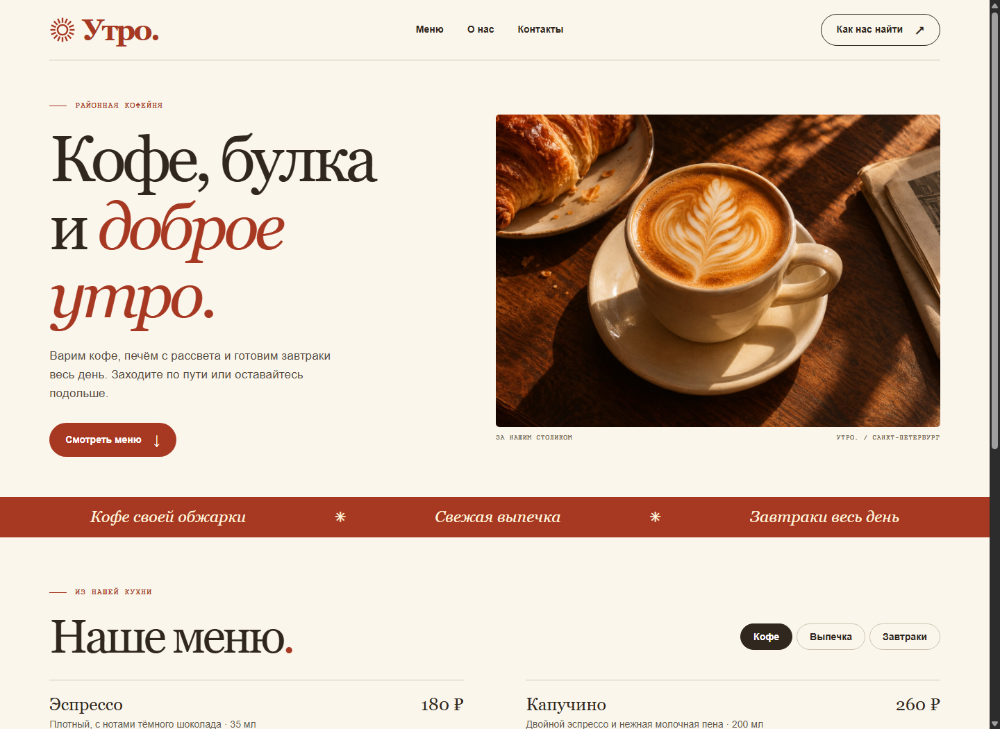

# Утро. — районная кофейня

Адаптивный сайт-визитка вымышленной петербургской кофейни. Гость может выбрать напиток или завтрак, посмотреть цену и узнать, когда открывается кофейня.

[Мобильная версия](screenshots/mobile.png)

## Как открыть сайт

Сохраните папку целиком и дважды щёлкните по `index.html`. Страница работает без установки программ, сборки и подключения к интернету.

## Как редактировать

| Файл | Что в нём менять |
| --- | --- |
| `index.html` | Тексты, блюда, цены, адрес и часы работы |
| `style.css` | Цвета, шрифты, отступы и раскладку на узких экранах |
| `menu.js` | Переключение между разделами меню |
| `assets/coffee.jpg` | Главную фотографию |
| `assets/sun.svg` | Знак кофейни |
| `screenshots/` | Скриншоты проекта для портфолио |

После изменения файла сохраните его и обновите страницу в браузере. Для проверки меню выберите по очереди «Выпечка», «Завтраки» и «Кофе». Если JavaScript отключён, все три раздела видны одновременно.

## О проекте

**Задача.** Передать атмосферу небольшой кофейни и дать гостю быстрый доступ к меню с телефона.

**Дизайн.** Кремовая бумага, терракотовые акценты, крупный заголовок с курсивом и фотография при утреннем свете. На широком экране текст и фотография стоят рядом, на узком — друг под другом.

**Технологии.** HTML, CSS, JavaScript. Сайт готов для статического хостинга. Текущая версия доступна локально.

Как создана фотография

Изображение для учебного проекта создано встроенным ImageGen. Запрос для генерации:

Photorealistic editorial still life for a neighborhood espresso bar website. Landscape 3:2 photographic print. A thick ivory ceramic cappuccino cup with beautiful rosetta latte art on an ivory saucer in foreground on a dark walnut table, flaky golden croissant on a small cream plate partly cropped along upper left, folded tan newspaper near right edge. High oblique camera angle, tactile surfaces, striking oblique golden morning light and long shadows, rich burnt umber, warm film grain, magazine-quality European coffee culture photograph, no overlay, no graphics, no typography.

